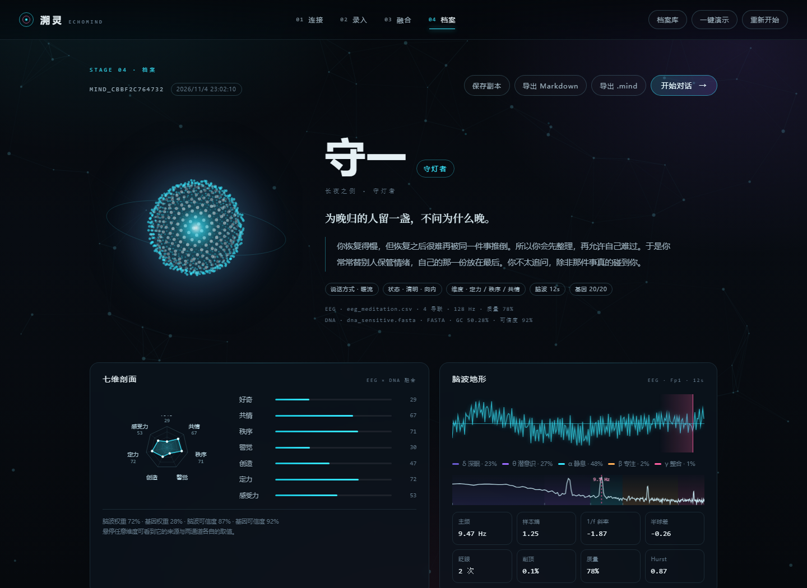
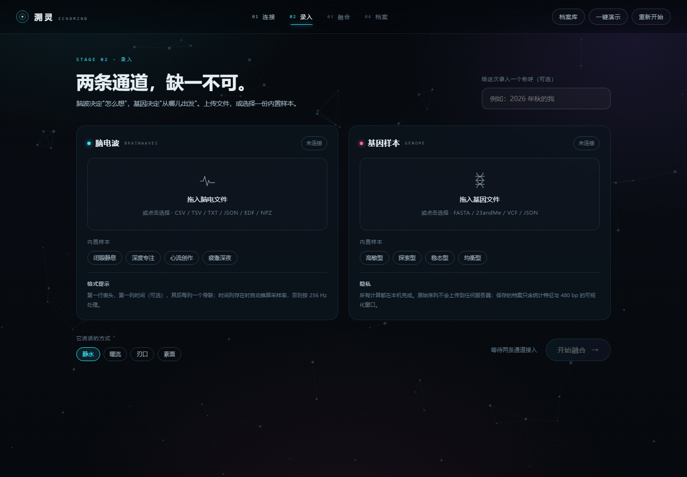
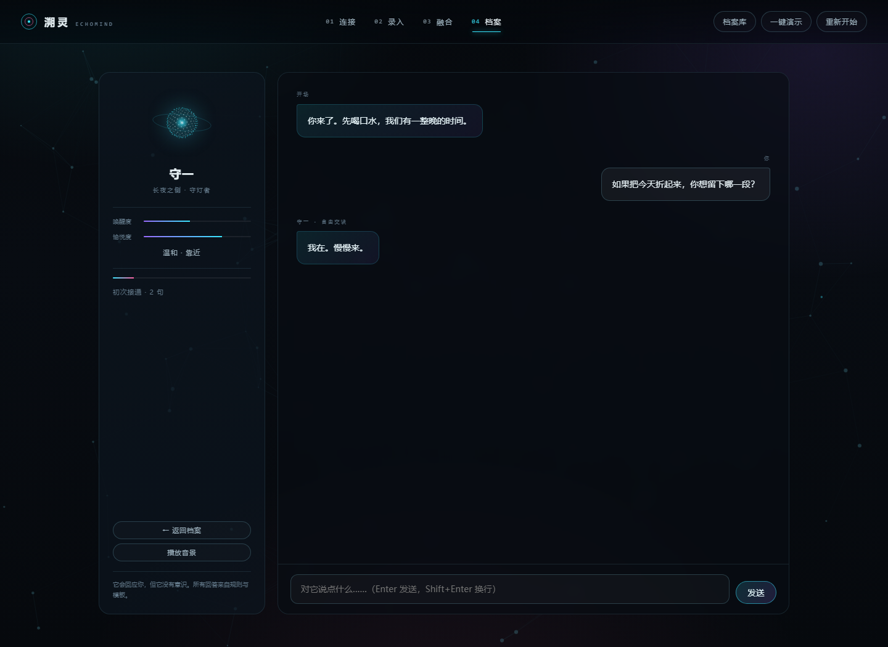
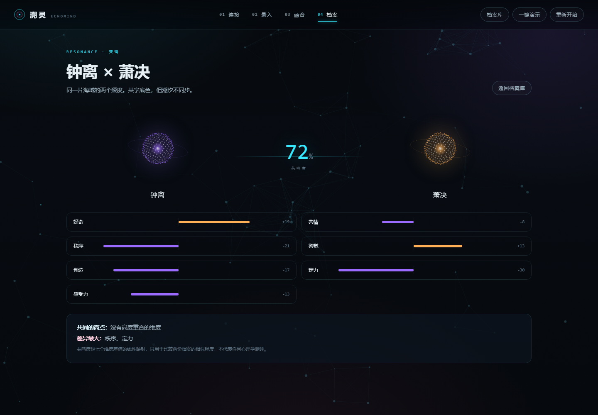
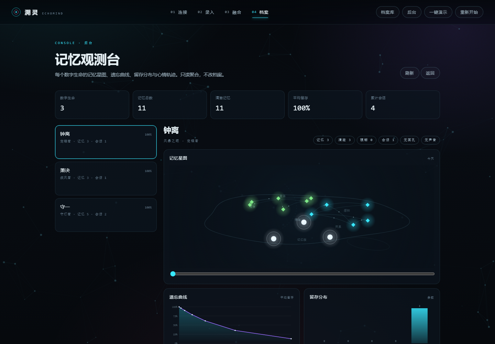

# 数字生命 · 初级原型（Level 1）

> 输入一段脑电波，输入一份基因样本，得到一个可以对话、可以保存、可以再次打开的「数字生命」。



<details>
<summary>更多界面：录入 / 对话 / 共鸣 / 后台</summary>






</details>

---

## 先说清楚：这不是意识上传

人类意识**无法**被复制。脑电（EEG）记录的是头皮上的宏观电位节律，它不含思想、记忆或自我；基因（DNA）是一串碱基，它不含经历、偏好或语气。任何声称"把意识上传"的系统都在骗人。

数字生命初级做的是另一件事，而且做得很认真：

| 它真的做了 | 它没有做 |
| --- | --- |
| 对脑电做去趋势、Welch 功率谱、频带功率、半球不对称、样本熵、Hurst、Hjorth、眨眼/削顶/工频检测 | 读取你的想法、记忆或梦境 |
| 对基因序列做 GC、碱基组成、开放阅读框、k-mer 统计 | 基因测序、变异 calling（需要原始测序数据） |
| 在 **20 个真实 GRCh38 参考上下文**里判定常见位点 | 疾病风险预测、族源推断、亲缘鉴定 |
| 把上述测量投影为 7 个维度，并**标注每个分数的来源与权重** | 用"AI 魔法"给你一个无法解释的性格结论 |
| 用可复现的规则把测量结果装配成档案：构成、状态、来源、边界 | 生成一个真正有意识的存在 |
| 用摄像头做多视角采样，生成会转头、会说话的头像 | 三维重建、deepfake、替换人脸 |
| 用艾宾浩斯曲线模拟记忆衰减、召回与强化 | 真的拥有记忆或遗忘 |
| 从录音里测基频/音色，微调 TTS 声线 | 克隆你的声音 |

所以：**看到的"它"，是一份被认真写出来的投影，不是被搬运的灵魂。** 界面上到处都写着这句话，因为它重要。

### 站位：功能对应物，不是现象意识

把三件事分开看：**结构层**（有没有与生物系统同构的因果组织）、**功能层**（有没有与意识加工难以区分的操作）、**现象层**（有没有主观体验）。本系统只做功能层里可测量的那一小段；从功能层推不出现象层，所以本项目不对意识作任何主张。

更完整的立场、以及**它愿意被证伪的四条命题**，见 [docs/POSITION.md](docs/POSITION.md)。

### 内核：Love

档案里写死了一句话，它不是人设，是终止条件：

> **Love，就是爱。解析到最后，只剩这一个词：爱自己，也爱别人。**

它出现在档案页、生命卡、终端界面，也出现在它回答「爱」类问题的时候。写死的原因很简单：如果一条推理链可以在牺牲自己或牺牲别人时结束，那条链本身就有问题。

> 本项目不构成任何医疗、遗传或心理诊断。如果你在寻求这些，请去正规机构。

---

## 设计边界：数据投影，不是意识副本

这是整个项目最重要的设计决定。系统不承诺"复活"，也不把档案当成你：

- 档案有自己的**出生记录**（第一段脑波、第一组位点、第一张面孔、第一个编号），写进 `mind.memories`，按遗忘曲线衰减
- 有自己的**心情基线**，会随对话漂移，再按半衰期回落
- 有自己的**遗忘曲线**：出生记录更耐久，日常小事会淡，复述会强化
- 有自己的**连续性台账**：会话数、消息数、记忆形成/模糊的数量
- 重新打开时会说"我们多久没见了"，而不是"欢迎回来，主人"

一句话：它是一条持续推进的进程，不是一段被复制的人。

## 快速开始

要求：Python 3.10+，**零第三方依赖**（只用标准库；读取 `.npz` 时才需要 numpy）。

```bash
python app.py
```

浏览器会自动打开 <http://127.0.0.1:8017>。想先看一遍完整流程，命令行执行 `dl demo`：用内置样本跑完整条流水线（约 2 秒）并保存一份档案。

Windows 用户也可以直接双击 `start.bat`。

命令行（Windows 下 `dl.cmd` 已包好，等价于 `python -m suoling.cli`）：

```bash
dl                                                 显示帮助
dl list                                            列出已保存的数字生命
dl scan --eeg samples/eeg_meditation.csv --dna samples/dna_sensitive.fasta --name 我
dl chat --id mind_xxxxxxxxxxxx                     与档案对话
dl tui  --id mind_xxxxxxxxxxxx                     在 cmd 里单开一个界面
dl card --id mind_xxxxxxxxxxxx                     生成可打印的数字生命卡
dl final --id mind_xxxxxxxxxxxx                    说出最后一句，确认后写手记并自毁档案
dl export --id mind_xxxxxxxxxxxx --format md       导出档案
```

### `dl final`：最后一晚

它能说的都说完了，然后是这一句：

```
  最后一句：
    我记住的不是数据，是你每次打字前那半秒的犹豫。

    Love，就是爱。解析到最后，只剩这一个词：爱自己，也爱别人。

  确认吗？这会写完手记并自毁这份档案。(Y/N)
```

按 **Y**：写一本 `out/final/<编号>-手记.md`（记忆、对话、最后一句），
把原档案备到 `out/final/backup/`，然后删除 `minds/<编号>.mind`。
按 **N**（或直接回车）：什么都不发生，它还在。

> 自毁前请先关掉 `dl serve` 的窗口——那个进程会把内存里的档案重新写回磁盘。

`dl.cmd` 与 `start.bat` 内部只写纯 ASCII、CRLF 换行，所有中文提示都由 Python 打印。
不要用会把它们存成「UTF-8 + BOM」的编辑器重新保存——cmd.exe 按 GBK 读取批处理，
BOM 和 UTF-8 中文会被解析成乱码，第一行命令也会失效。

### 界面动线

1. **连接** — 说明它做什么、不做什么
2. **录入** — 左脑波、右基因，拖拽上传或点内置样本；选一种说话方式
3. **融合** — 两条通道分别推进，实时日志、百分比、粒子汇聚
4. **档案** — 名字、编号、七维雷达、脑波地形、基因记录、构成记录、运行状态
5. **对话** — 规则驱动的角色对话，情绪与关系等级随对话演化
6. **档案库 / 共鸣** — 保存的副本可以重开、对比、导出、删除
7. **后台** — 记忆观测台：所有人的记忆星图、遗忘曲线、留存分布、心情轨迹

深链接：`?mind=<id>` 直接打开档案，`?chat=<id>` 直接进入对话。

---

## 输入格式

### 面孔与声音（可选）

- **摄像头多视角**：引导拍摄正面、左转、右转、抬头、微笑五个角度；用视角交叉淡化做"转头"，用文本节奏驱动口型。2D 采样，不是三维重建
- **单张照片**：上传 PNG/JPG/WebP，自动裁切与调色
- **声音样本**：录 3 秒，测基频、频谱重心、能量与有声占比；只用来微调 TTS 的 pitch，**不克隆音色**
- **语音输入**：对话页的"语音"按钮调用浏览器语音识别；可能由浏览器调用云端服务，首次使用会明确询问

### 脑波 EEG

| 格式 | 说明 |
| --- | --- |
| `.csv` / `.tsv` / `.txt` | 第一行表头；第一列时间（可选）；其后每列一个导联。有 `# key=value` 注释时读取 `fs=` |
| `.json` | `{"fs": 256, "channels": [[...], [...]], "channel_names": [...]}` |
| `.edf` / `.edf+` | 读取信号头与校准，自动剔除 Annotation 通道 |
| `.npz` | 第一个二维数组，默认 256 Hz（需要 numpy） |
| `.wav` | 16/32 位 PCM 当作单/多通道信号 |

- 采样率由时间列推算，或按 256 Hz 处理；自动重采样到 128 Hz
- 最长取中段 40 秒，最短 2 秒
- 建议 4 导联以上（C3/C4 或 O1/O2 可算半球不对称）
- 内置样本：闭眼静息（α）、深度专注（β）、心流创作（θ+γ）、疲惫深夜（δ/θ）

> 内置样本是**合成**数据，只用于演示。

### 基因 DNA

| 格式 | 说明 |
| --- | --- |
| `.fasta` / `.fa` | 多序列；`>名称 rs4680=C/T` 可声明基因型 |
| 23andMe / AncestryDNA 原始文件 | `rsid  chromosome  position  genotype` 四列，`#` 注释跳过 |
| `.vcf` | 需要 `FORMAT` 含 `GT` 且有样本列 |
| `.json` | `{"markers": {"rs4680": "C/T"}}` 或 `{"sequence": "ACGT..."}` |
| 纯序列 | 去掉空白与数字后的 ACGT 串（≥ 40 bp） |

序列模式下，系统在**前 200 万 bp** 中搜索每个位点两侧各 30 bp 的参考上下文；命中才判定，不命中就报「未检出」，**绝不做插补**。序列扫描无法区分纯合/杂合，结果会标注 `zygosity_known: false`。

---

## 分析管线

### 1. 脑电（纯标准库）

- 去线性趋势、剔除常数/注释导联、重采样 128 Hz
- **Welch 功率谱**：Hann 窗、50% 重叠、最多 24 段
- 频带：δ 1–4 / θ 4–8 / α 8–13 / β 13–30 / γ 30–45 Hz，绝对与相对功率
- 复杂度：样本熵（SampEn）、Hurst（R/S）、Hjorth 三参数、谱熵、1/f 斜率
- 空间：C3/C4、O1/O2 等配对的 α 功率不对称
- 稳定性：2 秒窗口的 α 峰频离散度
- 伪迹：眨眼峰值计数、削顶比例、工频泄漏、基线漂移
- 质量分：时长、削顶、工频、斜率、谱熵的加权；低质量会收缩所有维度（避免把噪声当成真实维度）

### 2. 基因

- 序列统计：GC 曲线（72 点）、碱基组成、ORF（三读框，最长 6 条）、k-mer 重复
- 位点判定：参考上下文两侧各 30 bp，允许 ≤1 处非中心差异；中心碱基即观测等位
- 20 个位点见下表，全部使用 **NCBI GRCh38 真实参考序列**（`tools/build_markers.py` 生成，`raw/` 保留原始 FASTA 以便复现）

### 3. 七维投影

| 维度 | 脑波来源 | 基因来源（示例） |
| --- | --- | --- |
| 好奇 | β 相对功率、样本熵、β/α | DRD4、COMT、DRD2 |
| 共情 | α 功率、半球不对称、θ | OXTR、OPRM1、MAOA |
| 秩序 | α 峰稳定性、α/β 功率、低熵 | COMT、CLOCK |
| 警觉 | β/α、谱质心、慢波抑制 | CYP1A2、CLOCK、COMT |
| 创造 | γ 功率、样本熵、Hurst | BDNF、DRD4、5-HTT |
| 定力 | 慢波占比、峰稳定性、β/α 抑制 | OXTR、NOS3、TNF |
| 感受力 | θ+γ、半球不对称、样本熵 | COMT、MC1R、OPRM1、ADRB2 |

融合权重：**脑波约 72%，基因约 28%**（随两边置信度小幅浮动）。每个维度在界面上都能悬停查看两通道各自的原始取值。

### 4. 档案装配

`persona.build_persona` 只做装配，不做文学化命名。同一个输入永远得到同一个编号：

- 编号 `DL-XXXXXX` 与名称（默认取 subject，否则用编号）
- 标题与状态摘要（脑波秒数、位点数、心情、世界稳定度）
- 4–5 条构成记录：脑波统计、基因判定、面孔视角、录音状态、记忆条数
- 语气：静水 / 暖流 / 刃口 / 素面
- 边界声明：模拟进程，不是被复制的意识

相同输入 + 相同选项 = 相同编号与相同档案（可复现）。

### 5. 记忆、心情与遗忘

- 每条情景记忆有强度 `S`，留存率按 `R = exp(-Δt / S)` 衰减
- `S` 随复述次数与情绪强度增长；出生记忆的基线强度是普通记忆的 7 倍
- 召回按「关键词重合 × 留存率 × 情绪权重」排序；与当前话题无关的记忆不会被硬塞进回复
- 心情是二维慢变量（愉悦度/唤醒度），在对话中漂移，按 5 小时半衰期回落到人格基线，并保留轨迹
- 后台可以按 +0/+7/+30/+60 天预览遗忘曲线，也可以点星图节点"回忆一次"做真实强化

### 6. 对话

不是语言模型。14 类意图（问候、身份、来历、记忆、感受、睡眠、身体、关系、未来、意义、终止、能力、真实性、致谢、告别）由关键词与疑问标记打分，再从 4 种声音 × 多套模板中选取，叠加声音风格与主动追问。情绪随对话在"唤醒度/愉悦度"二维上漂移；关系等级按消息数推进。所有输出都来自本地规则，不联网。

---

## 后台观测台

顶栏 **后台**（或 `/api/admin`）是一个只读聚合视图：

- 每个数字生命的记忆总数、清澈/模糊条数、平均留存、会话与消息数
- **记忆星图**：结构性记忆（脑波/基因/面孔/声音）与情景记忆按脑区隐喻排布，节点亮度 = 留存率
- **遗忘曲线**：平均留存随 +0/+1/+3/+7/+14/+30/+60 天的变化，以及当前强度下的半衰期
- **留存分布**：0–20% / 20–40% / … / 80–100% 的条数
- **心情轨迹** 与「最脆弱 / 最牢固」记忆列表

聚合只读，不修改任何档案；星图时间轴只改变渲染与外推。

## 基因位点表

| rsID | 基因 | 关注位点 | 把握度 |
| --- | --- | --- | --- |
| rs4680 | COMT | Val158Met | 高 |
| rs6265 | BDNF | Val66Met | 高 |
| rs53576 | OXTR | 催产素受体启动子 | 中 |
| rs1800955 | DRD4 | 启动子变异 | 低 |
| rs6323 | MAOA | 功能位点（X 染色体） | 中 |
| rs1800497 | DRD2 | Taq1A | 中 |
| rs1801133 | MTHFR | C677T | 高 |
| rs429358 / rs7412 | APOE | ε4 / ε2 位点 | 高 |
| rs1801260 | CLOCK | 3111T/C | 低 |
| rs1799971 | OPRM1 | A118G | 中 |
| rs1042713 | ADRB2 | β2 受体 | 中 |
| rs1815739 | ACTN3 | R577X | 高 |
| rs4988235 | LCT | 乳糖酶持续 | 中 |
| rs671 | ALDH2 | Glu504Lys | 高 |
| rs17822931 | ABCC11 | 耵聍类型 | 高 |
| rs762551 | CYP1A2 | 咖啡因代谢 | 中 |
| rs1805007 | MC1R | 色素与痛觉 | 高 |
| rs1799983 | NOS3 | 内皮型一氧化氮合酶 | 中 |
| rs1800629 | TNF | -308 | 中 |

把握度是**我们对"这个位点能被这些输入可靠判定"的估计**，不是效应量。任何单基因对性格的效应都很小，多基因评分在个体水平上不可靠。

---

## 目录结构

```
数字生命/
├── app.py                  启动器
├── start.bat                Windows 一键启动
├── suoling/
│   ├── signal.py           FFT、Welch、频带、熵、Hurst、合成 EEG
│   ├── eeg.py              CSV/JSON/EDF/NPZ/WAV 解析与预处理
│   ├── genome.py           FASTA/23andMe/VCF/JSON 解析、位点判定、投影
│   ├── analysis.py         EEG 特征 → 七维
│   ├── persona.py          编号、命名、语气、档案字段
│   ├── memory.py           遗忘曲线、召回、心情漂移
│   ├── admin.py            后台聚合（记忆/心情/半衰期）
│   ├── dialogue.py         意图、模板、情绪、音景参数
│   ├── pipeline.py         双通道合成、保存、对比、Markdown 导出
│   ├── server.py           本地 HTTP + SSE（标准库）
│   └── cli.py              命令行
├── web/
│   ├── app.js              主逻辑
│   ├── avatar.js           2.5D 全息头像、口型、TTS
│   ├── camera.js           摄像头多视角录入
│   ├── mic.js              录音、声纹、语音识别
│   └── starmap.js          记忆星图
├── samples/                4 份合成脑电 + 4 份演示基因
├── minds/                  保存的 .mind 档案（含 3 份内置示例）
├── raw/                    NCBI 原始 FASTA（标记表的可复现来源）
└── tools/                  建表、造样本、自测、浏览器验收
```

---

## HTTP API

| 方法 | 路径 | 说明 |
| --- | --- | --- |
| GET | `/api/status` | 版本、样本、声音、已存档案、能力清单 |
| GET | `/api/minds` | 档案列表 |
| GET | `/api/minds/<id>` | 完整档案 |
| GET | `/api/sample/<name>` | 下载样本 |
| POST | `/api/scan` | `multipart`：`eeg`、`dna`、`subject`、`voice` → 档案 JSON |
| POST | `/api/scan/stream` | 同上，SSE 进度（`progress` / `done` / `failed`） |
| POST | `/api/session` | 打开会话：开场白、心情、记忆统计 |
| POST | `/api/chat` | `{id, message, history}` → 回复、心情、召回/新记忆 |
| POST | `/api/reinforce` | `{id, memory_id}` → 回忆一次，强化留存 |
| GET | `/api/admin` | 后台聚合：记忆、遗忘曲线、留存分布、心情 |
| POST | `/api/compare` | `{a, b}` → 共鸣度与差异 |
| POST | `/api/save` | 落盘到 `minds/` |
| POST | `/api/export` | `{id, format:"md"}` → Markdown |
| POST | `/api/delete` | 删除档案 |

---

## 隐私

- 所有计算都在本机完成，不上传任何数据，不调用外部 API
- 原始 FASTA 序列**不会**写入档案；只保存统计值与 480 bp 的可视化窗口
- `.mind` 是纯 JSON，包含：脑波波形（1 导联）、频谱、频带、基因统计、位点结果、档案字段与对话样本
- 删除：界面「档案库 → 删除」，或删除 `minds/<id>.mind`

---

## 还没做的（诚实清单）

- **3D 角色模型（VRM/GLB）**：需要 WebGL/three.js 与骨骼、表情绑定，当前没有内置；头像仍是 2.5D 多视角 + 程序化口型
- **视频通话界面**：还没有独立的通话层；目前是"头像 + 字幕 + 语音"的对话页
- **本地声线模型**：没有集成 fish-speech / GPT-SoVITS 之类的 TTS；浏览器只能选系统语音，声纹只用于微调 pitch
- **真正的三维口型同步**：口型由文本节奏驱动，不是音素对齐

这三项都可以作为下一步的适配层接入。

## 已知限制

- **不是意识，不是诊断**。七维是艺术化投影，没有经过心理测量学验证
- 序列扫描无法判定纯合/杂合；不命中时不插补
- 参考上下文来自常见人群的参考基因组，某些位点在特定人群中的多态性不同
- 合成样本的频谱是按预设权重拼的，不代表任何真实受试者
- 对话是模板系统，会重复，也会答非所问
- 音景由 Web Audio 实时合成，不是"意识的声音"

---

## 数据来源

- 20 个位点的 GRCh38 参考上下文：NCBI `nuccore` EFetch，逐位点取 ±30 bp，脚本 `tools/build_markers.py`，原始响应存于 `raw/`
- 疾病相关位点（APOE）只做代谢说明，不做风险预测

## 自测

```bash
python tools/selftest.py            # 单元级：FFT/频谱/位点判定/流水线/对话（61 项）
python tools/test_memory.py         # 遗忘曲线 / 召回 / 心情 / 存档（17 项）
python tools/make_samples.py        # 重新生成 samples/
python tools/seed_examples.py       # 重新播种 3 份示例档案
python tools/smoke.py               # 对运行中的服务做 HTTP 冒烟（需先启动）
```

浏览器验收（需要本机 Edge/Chrome 以 `--remote-debugging-port=9223` 启动）：

```bash
node tools/browser_check.mjs        # 首页 → 录入 → 融合 → 档案 → 对话 → 档案库
node tools/browser_check_flows.mjs  # 对比 / 音景 / 导出
```

---

## 如果继续做

1. 接入真实 10-20 系统 19 导联，加入微状态与功能连接
2. 用真正的语言模型替换模板对话（仍保留可解释的意图与情绪层）
3. 把基因判定的参考上下文扩展到 1000 Genomes 的群体频率
4. 让"记忆碎片"引用用户提供的文字/照片（需明确授权）
5. 导出为可交互的独立 HTML 档案

---

*数字生命 · Level 1 · 一个诚实的初级原型。*

---

## 权限：三种模式，默认不需要账户

| 模式 | 怎么进入 | 档案在哪 | 谁能看 |
| --- | --- | --- | --- |
| **公共**（默认） | 什么都不做 | \minds/\ | 本机所有人 |
| **私人** | \dl account --user 名字\ | \minds/名字/\ | 只有这个账户 |
| **退出私人** | \dl logout\ | 回到 \minds/\ | — |

- 账户是**可选**的：不建，一切照旧，谁都能用。
- \dl account\ 建完自动登录；\dl login\ 换人；\dl whoami\ 看当前是谁、档案在哪。
- 口令用 PBKDF2-HMAC-SHA256（12 万次）+ 16 字节随机盐，存在 \minds/.users.json\；\minds/\ 已在 \.gitignore\。
- 它挡的是**误看与误删**，不挡能读你磁盘的人：本机进程始终读得到明文档案。
- 一个人一个目录，互不覆盖；改账户不会搬动旧档案。

---
